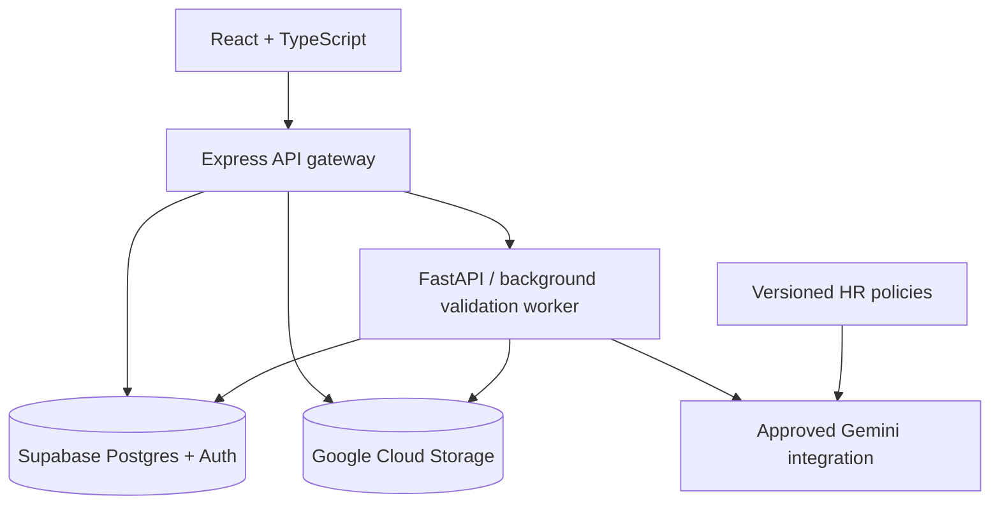
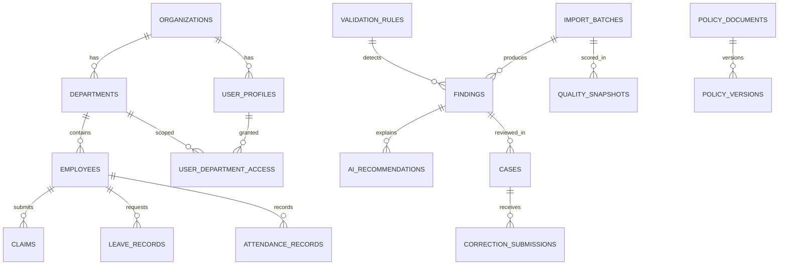

# AI Data Guardian — Full HR Web Application Specification

**Version:** 1.0 (proposed)  
**Date:** 2026-11-02  
**Status:** Design specification; not an implemented application  
**Project:** AI Data Integration (Eelyn & Nabila)  
**Primary audience:** HR officers, HR managers, administrators, employees, and developers

## 1. Executive summary

AI Data Guardian is a web application for monitoring the quality of HR data across employee master records, claims, leave, and attendance. HR teams upload CSV files and receive repeatable validation results, contextual privacy alerts, anomaly flags, evidence-linked findings, and AI-assisted recommendations grounded in versioned organizational policies. HR can assign a correction request to an employee, review the response, revalidate the record, close the case, and see updated departmental scores.

**Core product promise:** Upload → Validate → Investigate → Recommend → Request correction → Revalidate → Report.

**Primary success measure:** A complete, auditable correction workflow from a synthetic CSV upload to a closed issue, with objective before/after quality scoring.

### 1.1 Scope

**Included in the full application:**

- Multi-user HR authentication and role/department-based access.
- CSV import, schema mapping, previews, batch processing, and history.
- Employee, claim, leave, and attendance data views.
- Rule-based missing-value, validity, duplicate, consistency, timeliness, and PII checks.
- Statistical anomaly flags, reviewed rather than automatically treated as wrongdoing.
- Company/department/employee data-quality dashboards.
- Evidence-level issue review: file, row, column, failed rule, masked value, severity.
- Gemini-assisted, policy-grounded recommendations and HR policy chat.
- Cases, ownership, approvals, employee correction submissions, in-app notifications, optional email.
- Score history, audit trail, reports/exports, policy versioning, and admin settings.

**Explicitly outside initial deployment:** Payroll processing, employee performance scoring, fraud adjudication, automatic disciplinary action, autonomous HR master-data changes, production integrations to live HRIS systems, and model fine-tuning using confidential employee information.

### 1.2 Design assumptions

1. Initial country/currency is Malaysia/MYR; holidays, ID types, and retention are configurable rather than hardcoded.
2. HR departments each have a controlled data-access scope; cross-department access is restricted.
3. Employee records in the demo are **synthetic**, not based on actual people.
4. CSV imports are snapshots/evidence. Corrected canonical records and exports are versioned independently; original uploads are not silently overwritten.
5. A company or school Gemini Enterprise account does **not** by itself guarantee model API or cloud project access. Integrations require confirmation with the organization administrator.
6. Data quality percentages are computed from transparent rules, not invented by an LLM.

## 2. Actors and authorization

### 2.1 Roles

| Role | Scope | Main responsibilities |
|---|---|---|
| System Admin | Authorized organization-wide operational scope | Invite/suspend users, manage roles and department grants, configure rules and integrations, inspect audit events. Sensitive HR content access must be separately granted. |
| HR Manager | Assigned departments (or all if explicitly granted) | Review findings, approve/reject correction requests, manage staff assignments, approve policies, export authorized reports. |
| HR Officer | Assigned departments | Upload files, analyze data, triage findings, create employee correction requests, review responses. |
| Department Manager | Their department's aggregated dashboard and explicitly shared cases | See quality trends and limited action items; no unrestricted access to other employees' sensitive details. |
| Employee | Their own identity and assigned requests | See redacted correction requests, submit corrected information, view statuses. |

### 2.2 Permission matrix

Legend: **Y** allowed within authorized scope; **A** requires an approval/explicit privilege; **Own** own records only; **—** not allowed.

| Action | Admin | HR Manager | HR Officer | Dept Manager | Employee |
|---|---:|---:|---:|---:|---:|
| Manage user accounts/roles | Y | — | — | — | — |
| View overview and department aggregates | Y | Y | Y | Own dept | — |
| View employee-level findings | A | Y | Y | A | Own |
| Upload/import CSV | A | Y | Y | — | — |
| Create/assign issue cases | A | Y | Y | — | — |
| Approve employee corrections | A | Y | A | — | — |
| Respond to correction request | — | — | — | — | Own |
| Manage policy versions | Y | A | — | — | — |
| Export identifiable HR records | A | A | A | — | — |
| View audit log | Y | Restricted | — | — | Own actions |

Permission checks must be enforced in Express and the data-access layer, not merely by hiding UI controls. `admin` does not automatically mean unrestricted access to private employee fields.

### 2.3 Identity lifecycle

Admin sends invitation → recipient registers/activates identity via Supabase Auth → user profile and department grants are created → access token is verified on every request → roles can be changed/suspended → all sessions can be revoked when necessary. Enforce password-reset/MFA policy and never store plaintext passwords in application tables.

## 3. Information architecture and page-by-page UI

### 3.1 Navigation

**Public:** `/login`, `/forgot-password`, `/accept-invite`.

**HR shell sidebar:** Overview, Data Imports, Departments, Employees, Issue Center, AI Assistant, Policies, Notifications, Reports, Audit (authorized users), Administration (authorized users).

**Employee shell:** My Corrections, Notifications, My Profile.

**Global controls:** organization logo, date range, department filter where appropriate, global search (permission-filtered), notification bell, current-user menu/logout. On mobile, use a collapsible navigation drawer. All tables need search, filters, sorting, paging, loading/empty/error states, and keyboard accessibility.

### 3.2 Screens

| ID / Route | Accessible roles | Main UI sections | Main user interactions |
|---|---|---|---|
| P01 `/login` | Public | Brand panel, email/password or approved SSO, reset link | Sign in, show generic errors, navigate to role-appropriate home |
| P02 `/overview` | HR/Admin/Dept Manager | KPI cards (claim count/amount, leave days/requests, attendance records, overall DQ), date/department slicers, department bars, issue trends, privacy incidents, action queue | Select department/time range; click cards/charts to drill down |
| P03 `/imports` | HR/Admin | Upload history table with filename, type, uploader, status, rows, detected issues, timestamps | Start upload, compare batches, inspect failures, download authorized outputs |
| P04 `/imports/new` | HR/Admin | Drag/drop CSV, data type selection, schema mapping preview, encoding/date-format settings, row sampling, validation confirmation | Upload → inspect mapping → confirm import → progress; reject unsupported/malicious/oversized files |
| P05 `/imports/:id` | HR/Admin | Batch summary, scanning progress, quality dimensions, matched schema, table of CSV rows, color-coded problem cells, row/column issue sidebar, downloadable validation report | Filter to flagged rows, select a cell, open finding, export corrected version when approved |
| P06 `/departments` | HR/Admin/Dept Manager | Quality score cards by department, dimension heatmap, trend and open-issue counts | Filter by period/source/severity, open department |
| P07 `/departments/:id` | Scoped viewers | Department score details, issue breakdown, authorized employee roster and DQ%, improvement trend, top recurring rules | Select employee; open cases; create department report |
| P08 `/employees` | Scoped HR | Employee search, department/status filters, DQ score, open findings, latest import date | Open profile; export only authorized selection |
| P09 `/employees/:id` | Scoped HR | Basic employee profile, record-quality score (clearly not performance), tabs for claims/leave/attendance, issue history, outstanding corrections | Review per-record evidence, create case, navigate to source import |
| P10 `/issues` | Scoped HR | Inbox/work queue grouped by status, severity, type, age, owner; bulk triage for permitted non-sensitive actions | Assign, filter, review, acknowledge, escalate; no bulk auto-approval of corrections |
| P11 `/issues/:id` | Scoped HR | Masked offending data, exact provenance, failed rule, severity, confidence (for anomalies), policy reference, Gemini rationale, case timeline, action panel | Dismiss false positive with reason, request correction, approve/reject employee response, revalidate |
| P12 `/assistant` | HR/Admin | Ask-a-question chat, dataset/date/department scope picker, cited policies, linked finding IDs, feedback | Ask for summary/root causes/actions; never answer using unauthorized scopes |
| P13 `/policies` | HR Manager/Admin | Policy library, category, owner, version, effective dates, status, search | Upload draft policy, preview, submit for approval, retire previous policy |
| P14 `/policies/:id` | Authorized HR/Admin | Document preview, version history, rule mappings, citation-ready sections, change log | Publish approved version, link rule to policy section |
| P15 `/notifications` | All signed-in users | Inbox of assigned actions, due dates and status; read/unread state | Open linked case or employee request, mark read |
| P16 `/reports` | Authorized HR/Admin | Date/department/record-type filters, snapshot comparisons, resolution trends, PII incident counts | Generate PDF/CSV summaries and export with audit entry |
| P17 `/audit` | Admin/explicit auditors | Actor, action, entity, timestamp, source IP/device metadata (minimum necessary), filters | Read immutable activity history and export permitted logs |
| P18 `/admin/users` | Admin | User directory, roles, department grants, invitation statuses | Invite, suspend, assign scopes, revoke sessions |
| P19 `/admin/settings` | Admin | Department taxonomy, validation thresholds, scoring weights, notification templates, retention, integration health | Save versioned configuration, test integration connectivity |
| P20 `/my/corrections` | Employee | Outstanding/completed correction requests, deadlines, safe summaries | Open request, submit correction, track review status |
| P21 `/my/corrections/:id` | Employee owner | Requested fields, reason, masked prior value (if needed), secure edit form, allowed attachments, timeline | Submit changes; cannot edit unrelated HR records |
| P22 `/my/profile` | Employee | Minimal authorized account/profile fields | View and update only self-service permitted fields |

### 3.3 Dashboard behavior

- KPI definitions must be displayed in tooltips: claim amount versus number of claims are different metrics.
- Date ranges: this month, last 3 months, year-to-date, custom.
- Department score click → department detail → employee score click → record → issue, preserving current filter context.
- DQ score derived from the latest **completed** snapshot for the chosen period/source; processing/failed batches do not silently alter KPI totals.
- Show denominators and sample sizes; do not rank tiny departments unfairly.
- Alert badges: Critical (red), High (orange), Medium (yellow), Low (gray). Never rely on color alone.
- PII incident counts remain separate from DQ score and are only visible to authorized viewers.

## 4. Core business workflows

### W1. Import and analyze CSV

1. HR selects record type and uploads file to a short-lived private staging location using an authorized upload action.
2. Express validates identity, file size/type, department scope, and signed upload metadata; creates `import_batches` record.
3. FastAPI parses CSV in a restricted worker, detects dialect/encoding, validates schema, and returns a mapping preview.
4. HR confirms column mappings; worker validates records with rule engine, PII inspection, and anomaly checks.
5. Worker writes normalized records, per-check outcomes, findings, and a quality snapshot atomically/idempotently.
6. AI summarizes selected **redacted** findings grounded in current policies; failures here do not erase deterministic findings.
7. UI shows completed batch and issues; original CSV stays immutable and access controlled.

Batch statuses: `uploaded → mapping_required → queued → processing → completed | failed | cancelled`.

### W2. Issue-to-correction workflow

1. HR opens a `new` finding and may mark it `under_review`.
2. HR creates case and requests a specific, safe correction from the employee, with owner, due date, and policy explanation.
3. Employee gets an in-app notification (email can be added if authorized) and submits revised fields through their secure portal.
4. System validates allowed fields and stores proposed values in `correction_submissions`, not directly in canonical HR records.
5. HR approves or rejects with rationale. On approval, backend applies a versioned canonical-data change and reruns affected checks.
6. If checks pass, case becomes `resolved` and the score snapshot is refreshed. Otherwise case returns to `needs_more_info`.

Case statuses: `open`, `assigned`, `awaiting_employee`, `submitted`, `under_hr_review`, `needs_more_info`, `resolved`, `dismissed`, `escalated`.

Every status transition records actor, timestamp, previous/new state, and permitted comments. Do not send account numbers or sensitive field values in email/notifications.

### W3. Policy update

Admin/HR manager uploads a new policy **draft** → section extraction and review → mapping to affected rules → policy-owner approval → effective date/publish → AI retrieval index updates → new analyses cite the effective version. Historical findings keep their original policy reference; changing a policy does not silently rewrite prior audit evidence.

### W4. Comparing two uploads

Select compatible snapshots by record type/period → align using business keys → display added, removed, modified, and unchanged records → calculate resolved/new/reopened findings → generate an authorized diff report. If rows have nonunique keys, show an ambiguity notice and require mapping correction.

## 5. System architecture



### 5.1 Responsibilities

| Component | Technology | Responsibility |
|---|---|---|
| Frontend | React 19-compatible app, TypeScript, Vite, React Router, TanStack Query, React Hook Form, Zod, charting library | Typed screens, forms, guarded navigation, state, accessible charts and tables |
| API/middleware | Node.js, Express, TypeScript | JWT verification, RBAC, rate limits, endpoints, file-signing, workflows, notifications, audit logging |
| Analysis service | Python, FastAPI, pandas or Polars, Pydantic, statistical rules | CSV parsing, data normalization, quality checks, cell-level findings, score calculation, anomaly flags |
| AI adapter | Approved Gemini Enterprise/Agent Platform access | Policy retrieval/grounding and structured recommendation generation; never the source of truth for numeric scoring |
| Object store | Google Cloud Storage | Raw immutable uploads, generated approved exports, policy files, content hashes, retention controls |
| Database | Supabase PostgreSQL + Supabase Auth | Relational domain state, cases, findings, results, permissions, notifications, audit |
| Background jobs | Managed queue/task system or development-only worker | Long-running imports, retry logic, re-analysis, report generation |

Express is the only public application API. FastAPI should normally be private/service-to-service, with signed service authentication and no browser-direct access. Use a job queue rather than blocking a browser HTTP request for large imports. The first development iteration may run the worker locally.

### 5.2 Storage layout and lifecycle

- `imports/raw/{org_id}/{batch_id}/{sha256}.csv` — private originals, no public access.
- `imports/quarantine/{org_id}/{batch_id}/...` — restricted suspicious uploads; short retention.
- `exports/{org_id}/{export_id}/...` — approved sanitized or authorized outputs.
- `policies/{org_id}/{policy_version_id}/...` — approved source documents.
- Database stores object keys/metadata, not public GCS URLs.
- Signed download URLs should be short-lived and authorized per request. Configure object lifecycle and retention with HR/security approval.

### 5.3 Deployment environments

- Local: React dev server, Express, FastAPI, local Postgres/Supabase stack or configured dev project, mock/approved Gemini adapter.
- Staging: synthetic data only, dedicated Supabase/GCP resources, test identities.
- Production: separate secrets, least-privilege IAM, audit and monitoring, approved region/residency, backups, disaster-recovery plan.
- Suggested deploy shape: static frontend host + Cloud Run Express + Cloud Run FastAPI worker + managed queue + GCS + Supabase. Free tiers/credits can help development; never assume all services or enterprise API calls are free.

## 6. Relational database specification

### 6.1 Naming and common columns

Primary keys `uuid`, timestamps `timestamptz` in UTC, money `numeric(12,2)` with `currency_code`, dates `date`, human-readable IDs (`employee_code`, `claim_number`) as strings. Every business table has `organization_id` to enforce tenancy. Store external Auth identities in Supabase Auth; application `user_profiles.id` references `auth.users.id`.

Unless otherwise noted, tables have `id uuid pk`, `created_at`, `updated_at`. Keys, indexes, and foreign keys are enforced in migrations. Avoid storing raw sensitive CSV cell values in findings or logs.

### 6.2 Tables and critical fields

| Table | Important fields | Relationships / constraints |
|---|---|---|
| `organizations` | `name`, `timezone`, `default_currency`, `settings_json` | Top-level tenant |
| `departments` | `organization_id`, `code`, `name`, `parent_department_id`, `active` | Unique `(organization_id, code)` |
| `user_profiles` | `id=auth.users.id`, `organization_id`, `display_name`, `role`, `active`, `employee_id nullable`, `last_seen_at` | Role enum; `employee_id` unique when set |
| `user_department_access` | `user_id`, `department_id`, `access_level`, `granted_by` | Unique `(user_id, department_id)`; enforce same tenant |
| `employees` | `organization_id`, `employee_code`, `department_id`, `full_name`, `work_email`, `employment_status`, `effective_from`, `effective_to`, `record_version` | Unique active `(organization_id, employee_code)`; restrict employee data by scope |
| `claims` | `employee_id`, `claim_number`, `claim_date`, `category`, `amount`, `currency_code`, `description_redacted`, `status`, `source_batch_id`, `source_row` | Unique `(organization_id, claim_number)` when business rule requires; check amount >= 0; original free text retained only in restricted source |
| `leave_records` | `employee_id`, `leave_number`, `leave_type`, `start_date`, `end_date`, `days`, `status`, `source_batch_id`, `source_row` | Check `end_date >= start_date`; conflicting ranges checked at business layer |
| `attendance_records` | `employee_id`, `attendance_date`, `check_in_at`, `check_out_at`, `status`, `source_batch_id`, `source_row` | Check clock order when both present; uniqueness depends on shift policy |
| `import_batches` | `organization_id`, `uploaded_by`, `file_name`, `gcs_object_key`, `sha256`, `record_type`, `period_start`, `period_end`, `status`, `row_count`, `schema_map_json`, `error_summary` | Unique deduplication token within organization; references uploader |
| `import_row_lineage` | `batch_id`, `source_row_number`, `entity_type`, `entity_id`, `row_hash`, `parse_status` | Unique `(batch_id, source_row_number)` |
| `validation_rules` | `organization_id`, `rule_code`, `dimension`, `entity_type`, `severity`, `parameters_json`, `enabled`, `effective_from`, `policy_version_id` | Versioned/immutable releases; composite unique code/version |
| `validation_results` | `batch_id`, `rule_id`, `entity_type`, `entity_id`, `evaluated`, `passed`, `not_applicable`, `evaluated_at` | Unique check instance; supports reproducible scoring |
| `findings` | `organization_id`, `batch_id`, `rule_id`, `entity_type`, `entity_id`, `source_row_number`, `source_column`, `masked_preview`, `classification`, `severity`, `status`, `fingerprint`, `detection_confidence` | Unique fingerprint per analysis run; no raw bank/account/identity numbers |
| `ai_recommendations` | `finding_id`, `provider`, `model_version`, `policy_version_id`, `prompt_template_version`, `summary`, `recommended_action`, `citations_json`, `generated_at`, `reviewed_by` | Traceable to finding and policy; model output is advisory |
| `cases` | `finding_id`, `employee_id`, `assigned_hr_user_id`, `status`, `priority`, `due_at`, `requested_fields_json`, `resolution_note`, `resolved_at` | Case assigned to a permitted employee and HR owner; track valid state transitions |
| `correction_submissions` | `case_id`, `submitted_by`, `proposed_changes_json`, `attachments_json`, `status`, `reviewed_by`, `reviewed_at`, `review_reason` | Proposal before canonical update; field allowlist; sensitive payload encryption/access controls |
| `record_revisions` | `entity_type`, `entity_id`, `previous_version`, `new_version`, `change_summary_redacted`, `approved_by`, `source_case_id` | Append-only lineage; originals remain unchanged |
| `policy_documents` | `organization_id`, `code`, `title`, `category`, `owner_user_id` | Logical policy identity |
| `policy_versions` | `policy_document_id`, `version_label`, `gcs_object_key`, `status`, `effective_from`, `approved_by`, `approved_at`, `content_hash` | Only approved version becomes active by effective date; keep historical versions |
| `quality_snapshots` | `organization_id`, `batch_id`, `department_id nullable`, `employee_id nullable`, `period_start`, `period_end`, `dimension_scores_json`, `overall_score`, `checks_passed`, `checks_applicable`, `scoring_config_version` | `snapshot_level` organization/department/employee; do not conflate privacy incidents with scoring |
| `notifications` | `recipient_user_id`, `case_id nullable`, `type`, `title`, `safe_body`, `read_at`, `delivery_status`, `sent_at` | Never include secret/PII data in notification content |
| `audit_events` | `organization_id`, `actor_user_id`, `action`, `entity_type`, `entity_id`, `metadata_redacted`, `occurred_at`, `request_id` | Append-only; protect against arbitrary changes, set retention policy |
| `report_jobs` | `requested_by`, `filters_json`, `format`, `status`, `output_gcs_key`, `expires_at` | Authorized background report generation |

### 6.3 Relationships



### 6.4 Database implementation notes

- Use database migrations (e.g., a SQL migration tool) and seed scripts; never rely only on manual dashboard table edits.
- Add indexes on `(organization_id, department_id)`, employee foreign keys, claim date, case status/due date, findings severity/status, import batch/date, and audit occurrence.
- Keyset/page pagination for large tables; use materialized aggregates or precomputed `quality_snapshots` for dashboard speed.
- Use restricted views to omit sensitive raw text. If using Supabase client access, enable/test Row Level Security on each exposed table and enforce organization plus department membership. When Express uses a privileged service key, it must separately enforce identical authorization before querying; a service role may bypass RLS.
- Apply optimistic concurrency using `record_version` or `updated_at` to prevent lost HR edits.
- Store original CSV as evidence, parsed canonical rows as domain records, and submitted correction proposals as separate reviewable objects.

## 7. Validation and scoring specification

### 7.1 Rule engine contract

Each rule declares: `rule_code`, `version`, `entity_type`, `dimension`, `applicability`, `required_input_columns`, `severity`, `parameters`, `policy_reference`, `check(record, context)`. It returns `passed`, `failed`, or `not_applicable`, plus safe evidence: row, column, masked preview, reason, check version and optional anomaly confidence.

**Baseline rules:**

| Code | Entity | Detection | Example result |
|---|---|---|---|
| `EMP_REQUIRED_ID` | Employee/all | Missing required employee ID | High; row 22 `employee_id` blank |
| `EMP_INVALID_DEPT` | Employee | Department does not exist or is inactive | Medium; row 18 `department` invalid |
| `EMP_EMAIL_FORMAT` | Employee | Invalid email syntax | Low; row 7 `work_email` invalid |
| `CLM_DUPLICATE_ID` | Claim | Duplicate claim number where unique | High; rows 13/46 same ID |
| `CLM_POSSIBLE_DUP` | Claim | Same employee, date, amount, category and similar description | Medium anomaly; requires review |
| `CLM_PII_BANK` | Claim | Bank-account-like value in prohibited claim description field | Critical privacy alert; **masked** preview |
| `CLM_NEGATIVE_AMOUNT` | Claim | Negative amount where refunds are not permitted | Medium/High validity |
| `CLM_AMOUNT_ANOMALY` | Claim | Amount exceeds category-specific robust baseline | Medium anomaly; avoid declaring fraud |
| `LEV_DATE_ORDER` | Leave | End date before start date | High validity |
| `LEV_ATTENDANCE_OVERLAP` | Leave+attendance | Full-day leave overlaps confirmed full-day work attendance | Medium consistency; account for exceptions |
| `ATT_CHECKOUT_ORDER` | Attendance | Checkout precedes check-in after timezone/overnight-shift handling | Medium validity |
| `ATT_MISSING_CHECKOUT` | Attendance | Checkout missing after configured grace period | Medium completeness |
| `REC_STALE_UPDATE` | Employee | Last verified update older than policy threshold | Low timeliness |

**PII rule context is critical:** An employee's bank details may be legitimate inside a tightly restricted payroll module, but are prohibited in free-text claim descriptions. A detector should inspect field purpose, policy, and authorization, not mark every PII occurrence as intrinsically invalid.

### 7.2 Scoring formula

Default dimension weights (configurable and versioned):

- Completeness 30%
- Validity 25%
- Consistency 20%
- Uniqueness 15%
- Timeliness 10%

For dimension `d`:

`dimension_score_d = 100 * passed_applicable_checks_d / applicable_checks_d`.

`overall_score = SUM(weight_d * dimension_score_d) / SUM(weights_of_dimensions_with_applicable_checks)`.

`not_applicable` checks are **excluded**, not counted as failures. A dimension with zero applicable checks is `N/A`, and its weight is redistributed for that entity/scope. A department score aggregates applicable check outcomes for that department, with counts shown; it is not a simple unweighted average of employee percentages. All numbers are reproducible by rule/config version. PII incidents are shown as a **separate privacy metric**.

### 7.3 Anomaly detection

- Stage 1: deterministic thresholds/rules for transparent POC behavior.
- Stage 2: robust category-based statistics such as median/IQR or median absolute deviation, trained/calibrated on synthetic `hr_train.csv` after cleaning and partitioning.
- Flag unusual transactions for review, with a reason and affected baseline, never an accusation.
- Include safeguards for small sample sizes, seasonality, legitimate one-off expenses, overnight shifts, public holidays and changes in department composition.
- Freeze rule parameters before evaluating the independent holdout test dataset.

## 8. Gemini and policy-grounded AI

### 8.1 Recommended split of work

**Python rules own**: parse/normalize CSV, detect missing/invalid/duplicate/PII candidates, aggregate scores, compute anomalies and create exact evidence.

**Gemini owns**: explain findings in HR-friendly language, propose possible remediation, summarize department issues, answer policy questions with citations, create draft request text for human approval.

**HR owns**: decisions, employee contact approval, exception handling, permanent record changes and closure.

### 8.2 AI adapter interface

`generateRecommendation({finding_summary_redacted, policy_sections, safe_context, locale}) -> {summary, reason, recommended_action, policy_citations[], confidence_label, requires_hr_review}`.

Providers/configurations:

1. **Gemini Enterprise adapter** via permitted organization APIs and approved app/data store, if administrator authorizes access.
2. **Gemini model/Agent Platform adapter** if separate project/billing/API access is approved.
3. **Deterministic recommendation-template fallback** for local POC runs when organizational credentials are unavailable; UI must clearly label the source, not claim that Gemini generated a template.

### 8.3 Policy corpus

Minimum starter policies: `EMPLOYEE_DATA_STANDARD`, `CLAIMS_POLICY`, `LEAVE_POLICY`, `ATTENDANCE_POLICY`, `PII_HANDLING_POLICY`, `DATA_CORRECTION_SOP`, optionally department rules. Each has owner, effective date, version, scoped audience, section IDs, citations, retrieval permissions. Do not refer to uploading policy PDFs as “training model weights”; describe it as retrieval/grounding.

### 8.4 AI safeguards

- Mask or remove sensitive data **before** passing inputs to AI; only minimum necessary facts.
- Require strict structured output validation (Pydantic/Zod), schema version and bounded text lengths.
- Cite retrieved policy sections; when no supporting policy is found, explicitly say so rather than inventing a rule.
- Treat retrieved CSV text and policy content as untrusted inputs for prompt-injection defense.
- Scope retrieved policies and findings to the requesting user's authorization.
- Store provider/model/template/policy versions and timestamps with each recommendation.
- No automatic employee notification or canonical edit purely on LLM advice.
- Keep a fallback behavior for timeout, quota, unavailable API, unsafe/invalid response.

## 9. REST API specification

**Base URL:** `/api/v1`. All authenticated endpoints require `Authorization: Bearer <access_token>`; Express validates token and scope. Use `Idempotency-Key` on mutation endpoints such as import finalization, correction approval, and notifications. APIs return stable JSON error codes and correlation IDs. Large list endpoints use `?cursor=&limit=&sort=` with server-side authorization filters.

### 9.1 Auth and users

| Verb | Endpoint | Purpose | Minimum role |
|---|---|---|---|
| `GET` | `/me` | Current user, role, department scopes, preferences | Signed in |
| `POST` | `/auth/logout` | End application session/revoke if supported | Signed in |
| `GET` | `/users` | Filter/paginate user directory | Admin |
| `POST` | `/users/invitations` | Send secure invitation with role/scope | Admin |
| `PATCH` | `/users/:id` | Suspend/update profile or grants | Admin |
| `GET` | `/departments` | Authorized department list | HR/manager |
| `GET` | `/departments/:id` | Department metadata and authorized summaries | Scoped viewer |

Sign-in and reset can use Supabase Auth SDK endpoints directly; do not duplicate password storage in Express. Restrict public session signup when only invited HR accounts are allowed.

### 9.2 Imports and data views

| Verb | Endpoint | Purpose |
|---|---|---|
| `POST` | `/imports/upload-intent` | Validate proposed file and issue short-lived signed upload intent |
| `POST` | `/imports` | Finalize uploaded object, create batch, start schema preview |
| `POST` | `/imports/:id/mapping` | Confirm schema/column mapping and queue analysis |
| `GET` | `/imports` | Batch list filtered by type, dates, status, authorized department |
| `GET` | `/imports/:id` | Batch metadata, progress and summary |
| `GET` | `/imports/:id/rows` | Paginated redacted rows with cell-level finding pointers |
| `GET` | `/imports/:id/compare?otherBatchId=` | Authorized batch difference report |
| `POST` | `/imports/:id/reanalyze` | New run using specified rule/policy version; preserve prior results |
| `GET` | `/employees` | Authorized roster and quality summary |
| `GET` | `/employees/:id` | Authorized employee profile and overview |
| `GET` | `/employees/:id/records?type=` | Claims/leave/attendance under scope |
| `GET` | `/claims` | Authorized claim records and filters |
| `GET` | `/leave-records` | Authorized leave records |
| `GET` | `/attendance-records` | Authorized attendance records |

### 9.3 Quality, findings and cases

| Verb | Endpoint | Purpose |
|---|---|---|
| `GET` | `/dashboard/overview` | Organization/scope KPI and quality totals |
| `GET` | `/dashboard/departments/:id` | Department dimensions, trend and employee breakdown |
| `GET` | `/quality/employee/:id` | Employee record-quality score, check counts and dimensions |
| `GET` | `/findings` | Filter severity, issue type, department, owner, status |
| `GET` | `/findings/:id` | Exact source provenance, masked evidence, policy links |
| `PATCH` | `/findings/:id/status` | Triaged/dismissed/etc. with reason and audit |
| `POST` | `/findings/:id/recommendations` | Generate/retry advisory recommendation |
| `POST` | `/cases` | Create case from finding and employee target |
| `GET` | `/cases` | Role-scoped case queue |
| `GET` | `/cases/:id` | Case timeline, safe request fields, submissions |
| `PATCH` | `/cases/:id` | Assign, due date, state transition, escalation |
| `POST` | `/cases/:id/notify` | HR-approved notification action |
| `POST` | `/cases/:id/submissions` | Employee proposes correction to allowlisted fields |
| `POST` | `/cases/:id/submissions/:sid/review` | HR approves/rejects, triggers revalidation on approval |

### 9.4 AI, policies, reports, operations

| Verb | Endpoint | Purpose |
|---|---|---|
| `POST` | `/ai/chat` | Scoped policy-grounded questions; cited results |
| `GET` | `/policies` | Authorized policy list and active versions |
| `POST` | `/policies` | Draft policy metadata and upload registration |
| `POST` | `/policies/:id/versions/:vid/publish` | Authorized approval/publish with effective date |
| `GET` | `/notifications` | Own inbox |
| `PATCH` | `/notifications/:id/read` | Mark own notification read |
| `POST` | `/reports` | Queue authorized report generation |
| `GET` | `/reports/:id` | Report status and expiring download action |
| `GET` | `/audit` | Authorized filtered audit trail |
| `GET` | `/admin/rules` | Rule configuration and versions |
| `POST` | `/admin/rules/versions` | Create new validated rule configuration version |
| `GET` | `/admin/integrations/health` | Aggregated health without secrets |

### 9.5 Example request and response contracts

**Initiate upload**

```json
POST /api/v1/imports/upload-intent
{
  "fileName": "claims_oct_2026.csv",
  "fileSizeBytes": 274012,
  "contentType": "text/csv",
  "recordType": "claim",
  "departmentId": "department-uuid",
  "sha256": "hex-encoded-content-hash"
}
```

Response: `201` with `uploadId`, `expiresAt`, `objectKey`, and an upload instruction/signed URL; never log the signed URL. The next request verifies the stored object's hash/size before processing.

**Finding response** (example values are fictitious and masked):

```json
{
  "id": "finding-uuid",
  "ruleCode": "CLM_PII_BANK",
  "severity": "critical",
  "status": "new",
  "source": {"batchId": "batch-uuid", "fileName": "claims_oct_2026.csv", "row": 24, "column": "claim_description"},
  "preview": "Account ****6789",
  "message": "Bank-account-like information appears in a prohibited claim-description field.",
  "policy": {"code": "CLAIMS_POLICY", "version": "1.2", "section": "4.3"},
  "recommendedAction": "Request a revised claim description without account details.",
  "requiresHumanReview": true
}
```

**Submit correction:**

```json
POST /api/v1/cases/{caseId}/submissions
{
  "proposedChanges": {"claim_description": "Taxi reimbursement from client visit"},
  "comment": "Removed unnecessary payment details."
}
```

**Approve correction:** `POST /api/v1/cases/{caseId}/submissions/{submissionId}/review` with `{ "decision": "approve", "reason": "Validated against policy", "expectedRecordVersion": 3 }`.

**Error contract:** `{"error":{"code":"FORBIDDEN_SCOPE","message":"You do not have access to this department","requestId":"..."}}`. Use appropriate HTTP status codes (400, 401, 403, 404, 409, 413, 422, 429, 500/503). Do not leak whether an inaccessible employee ID exists.

## 10. Security, privacy, reliability, and governance

1. **Data minimization:** Demo with fully synthetic records; no real employee data in developer laptops, public Git repositories, demo screenshots or model prompts.
2. **Auth/RBAC:** Supabase Auth, MFA when configured, invitation-only HR access, department-scoped authorization in Express plus appropriately tested PostgreSQL RLS.
3. **Sensitive fields:** Distinguish required sensitive data in authorized payroll areas from prohibited account numbers in claim remarks. Restrict data at column and record level; mask findings and exports.
4. **AI prompt hygiene:** Redact before Gemini calls; avoid sending full CSV files to model unless policy explicitly permits. Secure policy retrieval, guard prompts against CSV-borne instructions.
5. **File security:** Private GCS buckets, encryption at rest/in transit, signed upload/download, MIME/magic/extension/content checks, size limits, CSV formula-injection handling in exports, no public bucket access.
6. **CSV processing:** Reject unexpected columns unless explicitly mapped; protect against malformed records, excessive row/column size, zip bombs (if archives ever allowed), formula injection, and unbounded memory usage.
7. **Audit:** Log identity, decision and timestamp; redact secrets and sensitive values; make records append-only with restricted writes.
8. **Retention/deletion:** Define retention periods, deletion authority, legal hold handling, backup/restore, and region residency with employer/security/legal stakeholders before production.
9. **Resilience:** Retriable idempotent imports, queue backoff, dead-letter handling, job cancellation, progress states, provider outages handled without losing deterministic findings.
10. **Observability:** Health endpoints, request IDs, structured redacted logs, error monitoring, job success/failure metrics, AI cost and latency monitoring.
11. **Human oversight:** No automatic disciplinary inference, no unsupervised corrections, no silent notifications, and audit dismissals as well as approvals.
12. **Access testing:** Mandatory tests that HR of department A cannot access department B via API, ID guessing, exports, reports, chat, or object downloads.

## 11. Synthetic training and test datasets

### 11.1 POC two-file constraint

Create exactly two **synthetic** CSV files for a portable academic demo:

- `hr_train.csv`: approximately 1,500 mixed HR event records, with known valid patterns plus controlled anomalies for baseline/rule calibration.
- `hr_test.csv`: approximately 400 separate events, with seeded unseen issues for objective test evaluation.

Both use a shared sparse event format with a required `record_type` (`employee`, `claim`, `leave`, `attendance`). A field is only required if applicable to that type. The sparse mixed design is a concession to the exactly-two-CSV deliverable; the application itself should support **four normalized CSV import types** for realistic operation.

### 11.2 Recommended CSV columns

`record_type, record_id, employee_id, employee_name, department, work_email, employment_status, event_date, claim_id, claim_category, claim_amount, claim_description, leave_id, leave_type, leave_start, leave_end, leave_days, check_in, check_out, approval_status, source_updated_at`

### 11.3 Synthetic generation and labels

- Create a realistic set of departments, hundreds of fictitious employee identities, plausible business dates and claim amounts in MYR.
- Seed exact-known issues: missing IDs, malformed emails, duplicate claim IDs, near-duplicate claims, synthetic bank-like strings in prohibited descriptions, incorrect date ordering, impossible attendance times, department mismatch, leave/attendance overlap, stale records.
- Use **fake** identifiers, fake contact data, and bank-like strings expressly invented for testing; do not use valid sensitive identities.
- Maintain a separate protected evaluation answer key/manifest (not supplied as a third CSV if the requirement is strictly two) with expected row/rule/issue labels.
- Avoid leakage: employee/date/group splits between train and test should be intentional; holdout contains new patterns, not only replicated anomalies.
- Train set calibrates thresholds and validates logic; test set measures precision, recall and false positives. This is **not** Gemini fine-tuning.

### 11.4 Suggested evaluation criteria

| Test | Target (initial acceptance proposal) |
|---|---|
| CSV handling | 100% of valid schema examples imported; invalid headers produce actionable mapping errors |
| Deterministic seeded issues | 100% recall on defined missing, format, exact duplicate and seeded PII rule cases |
| Anomaly findings | Report precision/recall with baseline; do not promise perfect detection |
| Evidence | Every finding links to exact batch, row, column (if applicable), and rule version |
| Authorization | All cross-department/other-employee unauthorized API tests denied |
| Correction lifecycle | Employee submits; HR approves; revalidation closes issue and updates snapshot |
| AI citation | Each policy-grounded recommendation cites an active approved policy or explicitly declares insufficient evidence |
| No AI availability | Deterministic analysis still completes when AI connector is unavailable |
| Demo | Entire scripted scenario completes with synthetic data without manual database editing |

## 12. Suggested repository structure

```text
ai-data-guardian/
├── apps/
│   ├── web/                     # React + TypeScript
│   │   └── src/{pages,components,features,api,hooks,routes,types}/
│   └── api/                     # Node + Express + TypeScript
│       └── src/{routes,controllers,services,middleware,validators}/
├── services/
│   └── quality-engine/          # Python + FastAPI
│       ├── app/{api,domain,rules,scoring,pii,anomalies,ai,jobs}/
│       └── tests/
├── database/
│   ├── migrations/
│   └── seeds/
├── datasets/
│   ├── synthetic/               # hr_train.csv, hr_test.csv, no real PII
│   └── README.md
├── policies/                     # Synthetic sample policy sources
├── docs/
│   ├── architecture.md
│   ├── api.md
│   ├── data-dictionary.md
│   ├── demo-script.md
│   ├── security.md
│   └── user-guide.md
├── .github/workflows/           # CI lint, typecheck, tests, scanning
├── .env.example                 # Variable names only; never secrets
├── docker-compose.yml           # Local development services as permitted
└── README.md
```

Recommended development tools: VS Code, Git/GitHub, ESLint/Prettier, Vitest/React Testing Library, Playwright, Pytest, Ruff, Postman/Bruno, Docker where permissible, and GitHub Actions. Adopt tooling versions that the team can support; the repo's lockfiles and CI should pin tested versions.

## 13. Development phases and deliverables

The schedule below is a **planning estimate**, not a guarantee. Team size, organization access, integration approvals and experience change the actual timeline.

| Phase | Focus | Concrete deliverable | Exit criteria |
|---|---|---|---|
| 0 — Discovery (week 1) | Confirm HR scenarios, sample policies, data dictionary, Gemini access, privacy constraints; agree MVP acceptance tests | Approved backlog, ERD, UI map, architecture decision record | Roles, permissions and validation definitions signed off |
| 1 — Foundation (weeks 2–3) | Monorepo, Git workflows, Supabase migrations/Auth, Express/FastAPI scaffolds, protected routes, navigation | Working login and dashboard shell | Authorized HR can sign in; cross-department requests denied |
| 2 — Import & quality engine (weeks 4–5) | GCS import, schema mapping, CSV parser, base rules, PII detection, deterministic scores, seeded test data | End-to-end upload and flagged row-level findings | Known cases pass unit/integration tests; idempotent import |
| 3 — Review & AI (weeks 6–7) | Issues, detail views, policy library, Gemini adapter and redacted prompts, citation UI | Explainable recommendations linked to row/cell and policy | Demo recommendation appears with citation or safe fallback |
| 4 — Employee loop (weeks 8–9) | Case assignment, notifications, employee correction portal, HR approval, revalidation | Full correction-to-resolution experience | Employee cannot edit unauthorized records; case closes on successful recheck |
| 5 — Hardening & final demo (weeks 10–11) | Analytics, exports, trends, audit, usability, access testing, monitoring, README/user guide, rehearsal | Demonstration-ready full scope | Passing critical tests and repeatable seeded demo |

If time is constrained, use Phase 0–3 as the **POC milestone** and prioritize Phase 4 for the defining full-workflow feature. Do not skip access control or redaction to save time.

### 13.1 Workstream ownership suggestion (two-person team)

| Workstream | Developer A | Developer B |
|---|---|---|
| Frontend | Lead React UI/navigation, dashboards, review screens | Support employee portal and form integrations |
| Node middleware/database | Auth/permissions, routes, notifications, schema migrations | API contract review and integration tests |
| Python + AI | API integration/consumption | Lead validation rules, PII/anomaly logic, Gemini adapter, metrics |
| Cross-cutting | E2E and usability testing | Synthetic data generation, policies, benchmarking |
| Shared | Security review, docs, final demo, GitHub PR review | Security review, docs, final demo, GitHub PR review |

## 14. Backlog epics and acceptance criteria

### E1 Identity and organization

- Admin invites at least two HR accounts and one employee account, grants department scope.
- Login, logout, expired session handling, account suspend and reset flows work.
- API security tests verify that no user can retrieve unauthorized employee information through guessed IDs or exports.

### E2 Upload and review

- Upload synthetic CSV, show preview and mapping, process asynchronously, display status.
- Clicking a flagged table cell opens the precise finding with masked preview and rule.
- Re-uploading the same file with the same idempotency key cannot duplicate domain data.

### E3 Quality and scoring

- Deterministic rules identify seeded missing/duplicate/invalid/PII scenarios.
- Department drill-down, employee score and overall score reconcile with the same applicable check counts.
- Applicable-check denominator, weights, version and timestamps are visible.

### E4 AI

- AI recommendations include actions and real policy references when source is available; otherwise state uncertainty.
- No raw account numbers in model request traces, notification bodies or general audit logs.
- Offline/failing Gemini adapter leaves the scanning process functional.

### E5 Workflow

- HR creates a case, employee receives safe notification, edits allowlisted field, HR approves, record revalidates, case resolves, score reflects change.
- Dismissed false positives require a reason and remain auditable.

### E6 Governance and reports

- Policy change increments version; historical citations remain resolvable.
- HR can compare two scans and export a filtered report after authorization.
- Audit view includes importer, reviewer, approver and timestamps.

## 15. Testing plan

- **Unit:** rule evaluation, score denominators, status machine, policy-effective-date lookup, redaction and currency/date parsing.
- **Integration:** Express ↔ DB Auth/RBAC, Express ↔ FastAPI, import workers ↔ GCS, notifications ↔ cases, Gemini mock.
- **End-to-end:** Playwright scripts for HR upload → issue → employee update → HR approval → resolved dashboard.
- **Security:** Cross-tenant/department IDOR checks, SQL/RLS policy tests, signed URL expiry, unsafe CSV formula handling, prompt injection from free text, excessive upload handling.
- **Evaluation:** Held-out `hr_test.csv` measured against an answer key; report false positives, false negatives, precision and recall by issue type.
- **Usability/accessibility:** Keyboard navigation, meaningful labels, color+text indicators, responsive layout, table readability, error messaging.
- **Operational:** Worker crash/retry, duplicate job, partial upload, Gemini timeout/quota errors, report export outage, long CSV processing.

## 16. Demo storyboard (approximately 8–12 minutes)

1. Introduce three demo identities: HR Manager, HR Officer, Employee; show scoped dashboards.
2. HR Officer opens overview: Finance has lower data-quality score, with a visible quality breakdown.
3. Upload `hr_test.csv`; confirm schema mapping and watch processing progress.
4. Open row 24 of a claim: masked bank-account-like number in claim remarks. Show exact source and policy reference.
5. Review a duplicate claim and leave/attendance inconsistency. Show severity vs anomaly flags and explain that AI does not adjudicate wrongdoing.
6. Gemini recommends removing confidential information from claim remarks and requesting employee clarification; HR approves the wording.
7. Employee signs in, receives notification, revises claim description, submits a correction.
8. HR approves; system revalidates; case moves to resolved. Show audit timeline and before/after score change.
9. Generate a department report and show the latest quality score/trend with outstanding cases.
10. Close by explaining architecture, synthetic training/test evaluation, access safeguards, remaining roadmap.

## 17. Decisions to confirm before coding

1. Does your organizational **Gemini Enterprise** license grant approved API access, relevant project permissions and billing? If not, use mock/template AI locally until approved.
2. Will real HR data ever be used, or is this an academic demonstration with synthetic data only?
3. Should department managers see **aggregates only** or any specific employee records? Default is aggregates only.
4. Are employee notifications in-app only for the demo, or do you have a sanctioned email delivery service?
5. What are the authoritative claim, leave, attendance and privacy policies and their version/effective dates?
6. Is the exact deliverable **two CSV files**, or may the full application use four normalized CSV import types with two composite evaluation files?
7. Is Supabase authorized by your organization for HR data? If not, use an approved GCP database arrangement and adapt the schema.

## 18. Official implementation references

- [Supabase Auth](https://supabase.com/docs/guides/auth)
- [Supabase Row Level Security](https://supabase.com/docs/guides/database/postgres/row-level-security)
- [Gemini Enterprise — overview for developers](https://docs.cloud.google.com/gemini/enterprise/docs/developer-guide)
- [Gemini Enterprise — StreamAssist API](https://docs.cloud.google.com/gemini/enterprise/docs/get-answers-from-streamassist)
- [Google Cloud Sensitive Data Protection — inspecting structured text](https://docs.cloud.google.com/sensitive-data-protection/docs/inspecting-structured-text)
- [Google Cloud Storage — object versioning](https://docs.cloud.google.com/storage/docs/object-versioning)

---

**Document end.** This is a proposed specification for implementation planning, not a statement that the application, integrations, or security controls have already been built or approved.
